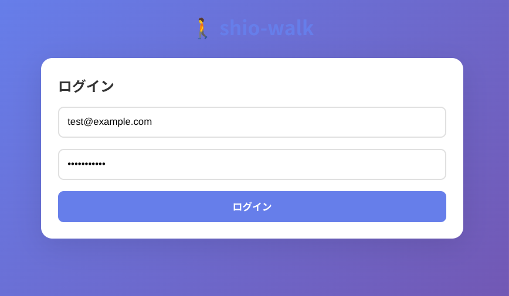
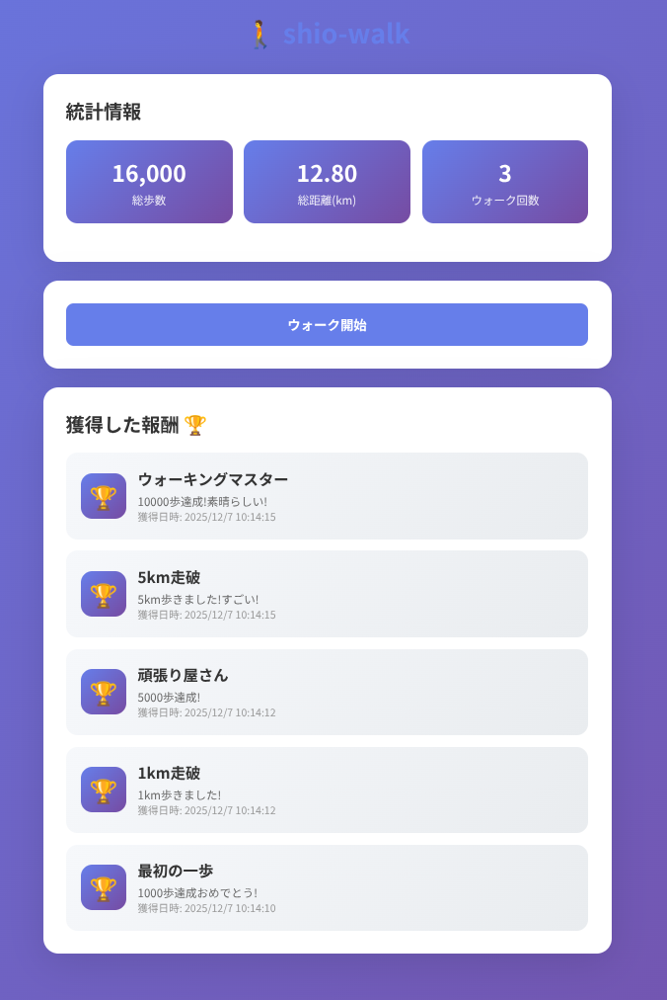

# shio-walk

ウォーキングの歩数・距離を記録し、累計が条件に届くと報酬（画像・音声）を解放するアプリです。
スマートフォンのブラウザ（PWA）で使い、歩数は加速度センサー、距離は GPS で測ります（手入力もできます）。




> [!IMPORTANT]
> バックエンド API を唯一の正しいデータ源 (Single Source of Truth) とします。
> API の応答の形や値がおかしいときは、フロントエンドで吸収せず API 側を直します（[docs/api.md](docs/api.md) の約束）。

## 今の状況（2026-11-19）

- 動くもの: 登録・ログイン（JWT）、ウォークの開始・保存・完了、累計の統計、報酬の解放、PWA（ホーム画面に追加）、センサー計測（歩数・GPS）と手入力、3 分ごと・画面が隠れる/戻るときの自動保存
- 実機の確認: iPhone の Safari で歩数・GPS が動くことを確認済み（2026-03）。ただし **画面ロック中・バックグラウンドではセンサーも GPS も止まる**（ブラウザの制約。Android の Chrome も同じ）
- 次: Android を先に対象にし、まず Android の Chrome で試す（画面を点けたままにする Wake Lock）。足りなければ Capacitor でアプリにして、端末の歩数計 (TYPE_STEP_COUNTER) や Health Connect を使う
- 詳しくは [docs/STATUS.md](docs/STATUS.md)

## 構成

| | |
|---|---|
| バックエンド | Clojure 1.11 / Ring + Compojure / Jetty / next.jdbc + HikariCP / PostgreSQL 15 (Docker) / migratus / Buddy (JWT, bcrypt) |
| フロントエンド | ClojureScript / Reagent + re-frame / shadow-cljs / PWA (manifest + Service Worker) |

```text
shio-walk/
├─ docker-compose.yml          PostgreSQL (コンテナ名 shio-walk-db)
├─ backend/
│  ├─ deps.edn                 :run :migrate :reset :test
│  ├─ resources/migrations/    001〜004 (*.up.sql / *.down.sql)
│  ├─ src/shio_walk/
│  │  ├─ core.clj              サーバー起動
│  │  ├─ routes.clj            ルーティングとミドルウェアの順序
│  │  ├─ middleware.clj        JWT 認証・CORS・例外
│  │  ├─ config.clj            設定 (環境変数)
│  │  ├─ db.clj                DB 操作 (キーは snake_case)
│  │  ├─ convert.clj           DB の行 → API の JSON (kebab-case・ISO 時刻)
│  │  ├─ auth/ walks/ rewards/ ハンドラ
│  │  └─ migrate.clj reset.clj
│  └─ test/shio_walk/api_test.clj
├─ frontend/
│  ├─ shadow-cljs.edn          :app (ブラウザ) / :test (node)。開発サーバーは /api/ をバックエンドへ転送
│  ├─ public/                  index.html, manifest.json, sw.js, css/
│  ├─ src/shio_walk/           core events subs db api sensors views/
│  ├─ dev/shio_walk/dev_http.clj  開発サーバーの転送の条件
│  └─ test/shio_walk/events_test.cljs
├─ scripts/test-backend.sh     API のテスト (別の DB shio_walk_test を使う)
└─ docs/                       api.md SETUP.md STATUS.md debug-notes.md study*.md archive/
```

## 動かし方（PC で開発するとき）

[babashka](https://babashka.org/) があれば、リポジトリの直下でまとめて起動できます（初回は先に `cd frontend && npm install`）。

```bash
bb dev        # DB を起動して待ち、バックエンド (:3000) と画面 (:8080) を起動。出力に [backend] [frontend] が付く。Ctrl-C で両方止まる
bb migrate    # マイグレーション
bb test       # テスト
bb tasks      # 一覧
```

すでに 3000 や 8080 で動いているものは起動しません（片方だけ別の端末で動かしていても使える）。

個別に起動するときは:

```bash
# 1. DB
docker compose up -d

# 2. マイグレーション (初回と、migrations にファイルが増えたとき)
cd backend && clj -M:migrate migrate

# 3. バックエンド (http://localhost:3000)
./run.sh                      # backend/ で。DB_* と JWT_SECRET などは環境変数で変えられる

# 4. フロントエンド (http://localhost:8080)
cd frontend && npm install && npx shadow-cljs watch app
```

ブラウザで http://localhost:8080 を開きます。開発サーバーが `/api/` をバックエンド (`SHIO_BACKEND`、既定 `http://localhost:3000`) へ転送するので、画面と API は同じ Origin になります（CORS の設定や API の URL の書き換えは要りません）。

スマートフォンから試すときは https が必要です（センサーと GPS は https でしか使えない）。手順は [docs/SETUP.md](docs/SETUP.md)。

### 設定（環境変数）

| 変数 | 既定 | 意味 |
|---|---|---|
| `DB_HOST` `DB_PORT` `DB_NAME` `DB_USER` `DB_PASSWORD` | localhost 5432 shio_walk shio_user shiopass | DB |
| `PORT` | 3000 | バックエンドのポート |
| `JWT_SECRET` | 開発用の固定値 | **外から使えるサーバーでは必ず設定する**（未設定だと起動時に警告） |
| `CORS_ORIGINS` | 未設定 = すべて許す | 画面を別の Origin から出すときに許す Origin（カンマ区切り） |
| `SHIO_BACKEND` | http://localhost:3000 | 開発サーバーが `/api/` を転送する先 |
| `SHIO_API_BASE` | /api | 画面が呼ぶ API の場所（ビルド時に埋め込む。別の Origin の API を使うときだけ） |

## テスト

```bash
./scripts/test-backend.sh        # API のテスト。DB shio_walk_test を作って使う (開発用の DB は触らない)
cd frontend && npm test          # 画面の状態遷移 (re-frame のイベント) のテスト。node で動かす
```

## データの片付け（開発用）

```bash
cd backend && clj -M:reset       # ウォーク・統計・獲得報酬を消す (ユーザーと報酬マスタは残す)
```

DB の時刻は UTC（`TIMESTAMPTZ`）で持ち、API は `2026-03-07T23:14:16.077Z` の形で返します。

## ドキュメント

- [docs/STATUS.md](docs/STATUS.md) — 今の状況・既知の問題・次の作業
- [docs/api.md](docs/api.md) — API の約束と各エンドポイント
- [docs/SETUP.md](docs/SETUP.md) — スマートフォンから試すための https の準備
- [docs/debug-notes.md](docs/debug-notes.md) — 過去の大きな不具合と、そこから決めた設計の方針（読む価値が高い）
- [docs/studyindex.md](docs/studyindex.md) / [docs/study.md](docs/study.md) — コードを読んで学んだことの記録
- [docs/archive/](docs/archive/) — 以前の引き継ぎ用 JSON やデバッグの記録（今の状況は STATUS.md が正）
- [CLAUDE.md](CLAUDE.md) / [GEMINI.md](GEMINI.md) — AI のコーディング支援に読ませる指示

## ライセンス

MIT License
